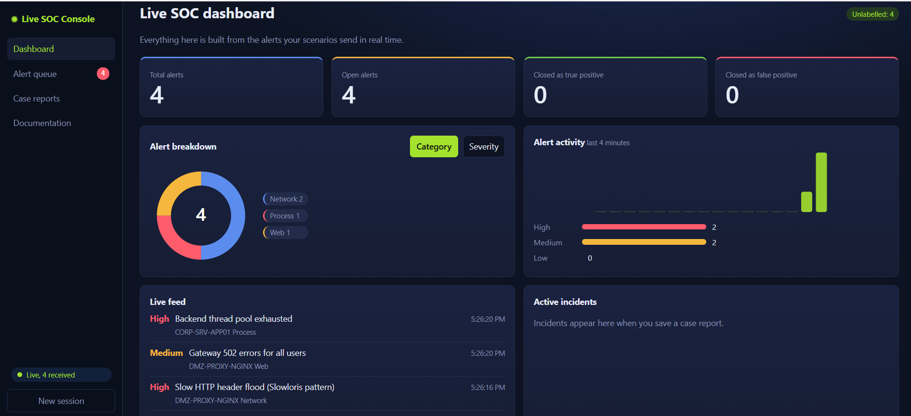
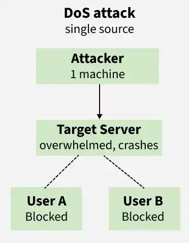
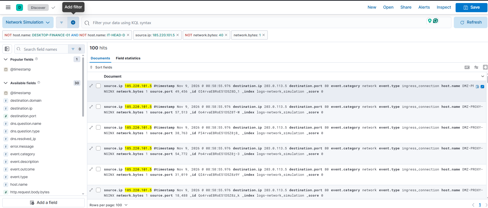
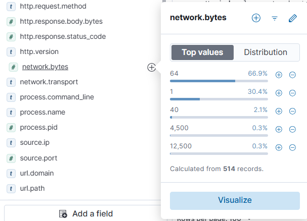
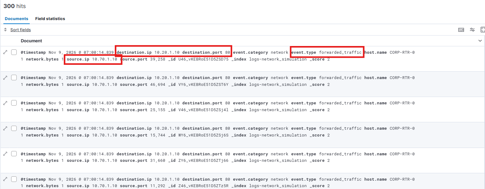
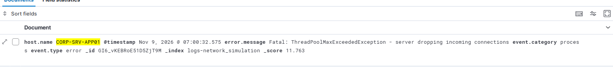
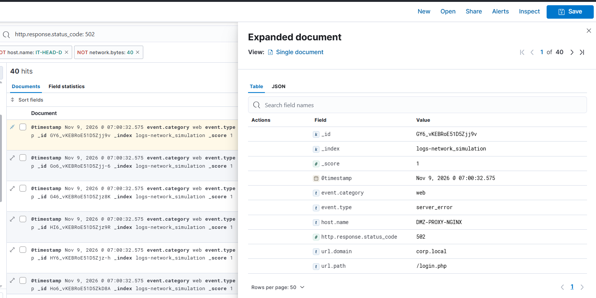
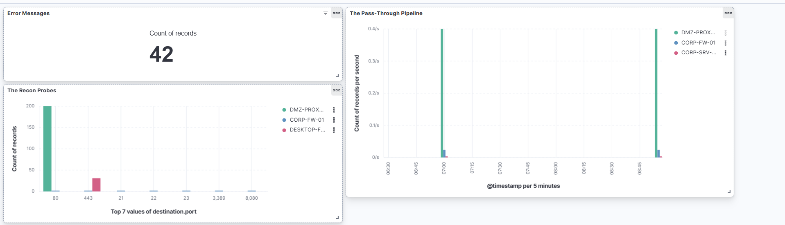

# SOC Simulator - DOS Attack Simulation

## Scenario

An attacker looking for open ports from which they can exploit these weak entry points. To bring down an organization working server.

It is a company holiday, so the corporate network is mostly quiet [2026-11-08T14:39:41.059+00:00]. Only two employees are working remotely from home over the company VPN: the **Finance Head**, who is reviewing an internal spreadsheet, and the IT Head, who is checking the **internal monitoring systems**.

Suddenly, an external attacker launches a cyberattack from the internet. They want to crash the company’s internal application server, but because it is hidden deep inside the private corporate network, they have to target the public-facing Perimeter Proxy Server sitting in the DMZ.

**Problem Statement**

The attacker uses a technique called a Slowloris attack. Instead of blasting the network with massive amounts of traffic all at once, the attacker opens hundreds of web connections and sends the HTTP requests incredibly slowly—literally 1 byte at a time.

The public gateway server (built on a resilient architecture like Nginx) handles these slow connections easily. However, due to a critical configuration mistake, the proxy server does not wait to verify the web requests. It blindly passes these incomplete, slow-moving connection lines right through the perimeter firewall and deep into the internal network.

## DOS Attack Working

A Denial-of-Service (DoS) attack is a cyber attack designed to make a website, network, or server unavailable to its legitimate users. 

It is a cyber attack designed to make a website, network, or server unavailable to its legitimate users. Instead of stealing data or breaching security, the attacker disrupts normal operations by overwhelming the target system with fake traffic, excessive data, or malicious requests until it crashes or slows down drastically.

### DOS Attack Vulnerable Ports

| **Rank** | **Port / Protocol** | **Core Service**          | **Primary DoS Attack Vector**                 | **Why It Is Vulnerable / Impact**                                                                                                                                                                |
|:--------:|:-------------------:|---------------------------|-----------------------------------------------|--------------------------------------------------------------------------------------------------------------------------------------------------------------------------------------------------|
| **1**    | TCP 443             | Web (HTTPS)               | TLS/SSL Handshake Floods, Layer 7 HTTP Floods | **Most Vulnerable**. Asymmetric cryptography requires massive server CPU power to decrypt fake handshakes, allowing low traffic volumes to crash the server.                                         |
| **2**    | TCP 80              | Web (HTTP)                | Slowloris, Slow POST attacks                  | **Highly Vulnerable**. Attackers open thousands of connections and send data agonizingly slowly, filling the connection tables and locking out legitimate users.                                     |
| **3**    | UDP/TCP 53          | DNS                       | DNS Query Floods, NXDOMAIN Attacks            | **Highly Vulnerable**. Flooding the server with lookups for non-existent domains forces the DNS architecture to exhaust its cache and crash backend systems.                                         |
| **4**    | TCP 22 / 3389       | Remote Access (SSH / RDP) | TCP Connection Floods, Session Exhaustion     | **Moderately Vulnerable**. These services have strict maximum limits on active administrative sessions. Flooding them completely locks IT staff out from mitigating the issue.                       |
| **5**    | TCP 25              | Email (SMTP)              | SMTP Floods, Queue Exhaustion                 | **Moderately Vulnerable**. Attackers flood the mail transfer agent with massive quantities of fake emails, filling up storage disks and saturating processing queues.                                |
| **6**    | Various UDP         | Custom APIs, VPNs, Gaming | Protocol Fuzzing, Application Exploits        | **Low-to-Moderate**. Vulnerability depends entirely on how the underlying software handles unexpected inputs or unhandled application errors.                                                        |
| **7**    | Any Closed Port     | Non-listening Ports       | Volumetric UDP / ICMP Floods, SYN Floods      | **Least Vulnerable**. The firewall or OS instantly drops the traffic. Attackers can only achieve a DoS here by using a massive botnet to physically overwhelm and choke the internet bandwidth pipe. |

## Incident Documentation 

### DOS Attack

**Incident Classification:** High 

**Incident Handler:** Rishab Shorey

- **Time of attack:** Nov 9, 2026 @ 07:00:32.575
- **Attack Type:**  DOS Attack 
- **Indicator of Compromise:** 

    - 185.220.101.5 (Un-Verfied source of IP do not belong to any external server or service)   
    - Suspicious Network Activity: 1 Byte

- Reason for Incident Classification:
- Escalation Required: Yes

**Details for Incident Taken place**

- We see the suspicious IP trying to send a tcp connection request up to the a IP address which belongs to the external server and the firewall is blocking the attackers continous attempt. As that port is closed for the web server

**Source-IP:**  185.220.101.5

- When the firewall detects a connection request to 
the open port 80 then the things changes from here, as an successfull ingress connection is taking place.

This is a misconfiguration within the firewall and the public facing server too.

And we should also notice that there is network bytes mentioned from the source which is a fixed value of 1 byte, WHICH is not possible.

So we now look at the network bytes and see any suspicious network activity took place and yes it does: We are able to see that 

All the 1 byte, can be filtered and are having an ingress connection means it does communicate to someone inside the network so...lets leave the source UP address out and use the 1 byte address to check and see how this is exactly what is taking place. 

**Filter used:** network.bytes : 1 and destination.port : 80 and de
 
Now we look at the results, about 300 results of continous 1 byte of traffic data is being sent from the **IP Address: 10.70.1.10**, which represents our public facing server...technically an act of reverse proxy from internet to the destination.

If we notice the destination address is given as: 10.20.1.10

We are able to notice a Fatal Error Message: ThreadPoolMaxExceededException - server dropping incoming connections

So it drops internal connection, which means now any request that comes internally to the server and the conenction between the internal server and the public facing server gets timed out.

Now the public facing server tried connecting with the server, so the connection will not take and fail.

**Event Outcome:**

The public gateway proxy (DMZ-PROXY-NGINX) realizes the backend application server is no longer responding to requests. The perimeter immediately begins throwing massive, continuous walls of HTTP 502 Bad Gateway errors

**Remediation & Post-Incident Summary**: 

- Ensure the Attackers IP address is blocked which in this case was: 185.220.101.5

- Ensure the the public facing server does not blindly pass the packet or request ahead to the internal server. 
    - It should drop those request whose execution attempt more than a certain time frame to complete the request, so that this does not create an overhead.  

- The internal server must allocate a dedicated, persistent system execution thread to every single connection it receives.

- Security Audits to check and verify that the system is working and resistant from such attack is also assured.
