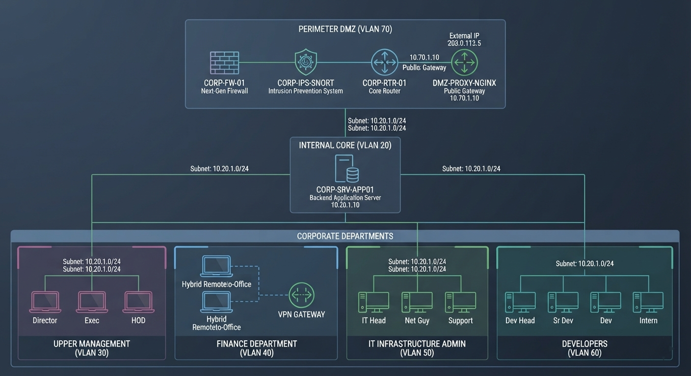
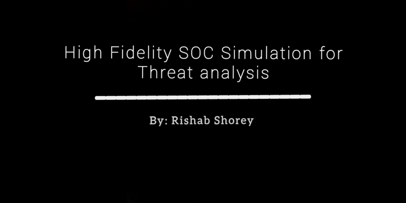
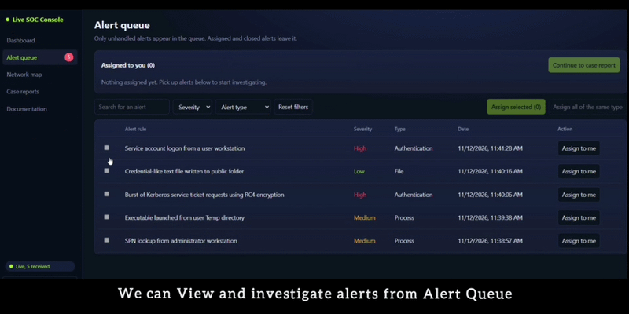
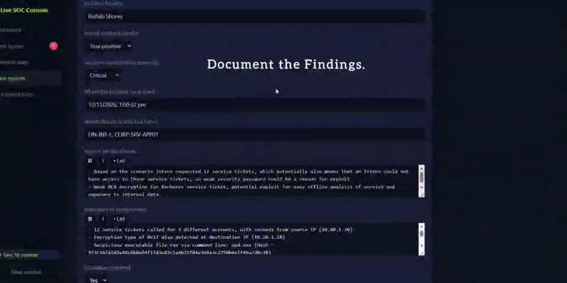

# High-Fidelity Televisory Emulation & Behavioral Analysis

## Architectural Setup

## SOC-Simulation Working

### Part 1: Network Mapping 

### Part 2: View the Alert & Investigate

### Part 3: Investigate, Document and Remidiate

### 𝐏𝐫𝐨𝐣𝐞𝐜𝐭 𝐒𝐜𝐨𝐩𝐞 & 𝐎𝐛𝐣𝐞𝐜𝐭𝐢𝐯𝐞:

Designed and engineered a lightweight, containerised security testing architecture using 𝑫𝒐𝒄𝒌𝒆𝒓 𝑬𝒍𝒂𝒔𝒕𝒊𝒄𝒔𝒆𝒂𝒓𝒄𝒉, 𝒂𝒏𝒅 𝑲𝒊𝒃𝒂𝒏𝒂 to model enterprise-grade defensive environments. 

- The primary motive of this project was to build a Telemetry Simulation Framework capable of programmatically injecting realistic background network noise interleaved with high-fidelity adversary indicators, rather than executing hazardous live exploits. 

- The platform programmatically replicates the exact, granular log strings, metadata schemas, and architectural fingerprints left behind across the 𝐂𝐲𝐛𝐞𝐫 𝐊𝐢𝐥𝐥 𝐂𝐡𝐚𝐢𝐧, providing a safe, space-efficient sandbox to train and validate enterprise threat-hunting capabilities.

### Core Skillset and Defensive Strategic Approach

- 𝑷𝒓𝒐𝒈𝒓𝒂𝒎𝒎𝒂𝒕𝒊𝒄 𝑻𝒆𝒍𝒆𝒎𝒆𝒕𝒓𝒚 𝑬𝒎𝒖𝒍𝒂𝒕𝒊𝒐𝒏: Programmed an automated script engine using PowerShell HTTP REST APIs to directly stream structured event data into the SIEM database.

- 𝑶𝒓𝒈𝒂𝒏𝒊𝒛𝒂𝒕𝒊𝒐𝒏𝒂𝒍 𝑪𝒐𝒏𝒕𝒆𝒙𝒕𝒖𝒂𝒍𝒊𝒔𝒂𝒕𝒊𝒐𝒏: Formulated a multi-tier corporate asset registry spanning distinct VLAN subnets, specifying internal IPs, external residential public ranges, MAC schemas, and user privileges for Hybrid, On-Premise, and WFH operational baselines. 

- 𝑫𝒂𝒕𝒂 𝑽𝒂𝒍𝒊𝒅𝒂𝒕𝒊𝒐𝒏 & 𝑩𝒆𝒉𝒂𝒗𝒊𝒐𝒓𝒂𝒍 𝑨𝒏𝒂𝒍𝒚𝒕𝒊𝒄𝒔: Acted as the primary Security Analyst to resolve schema matching, dynamic field mapping, and time zone synchronization constraints within Kibana Data Views.
